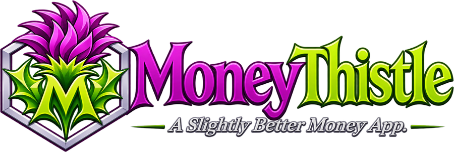
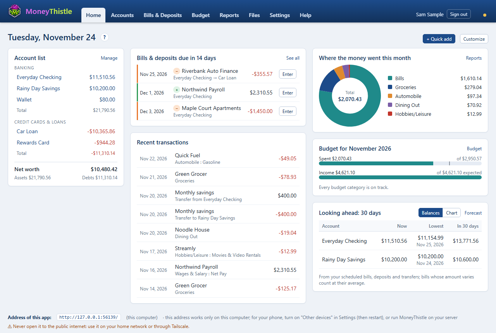
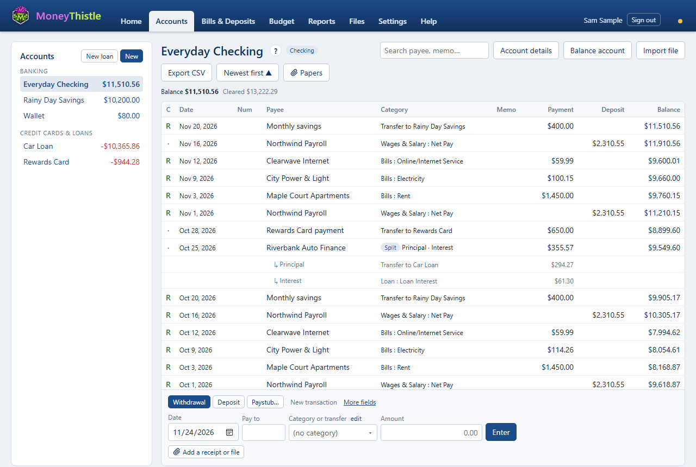
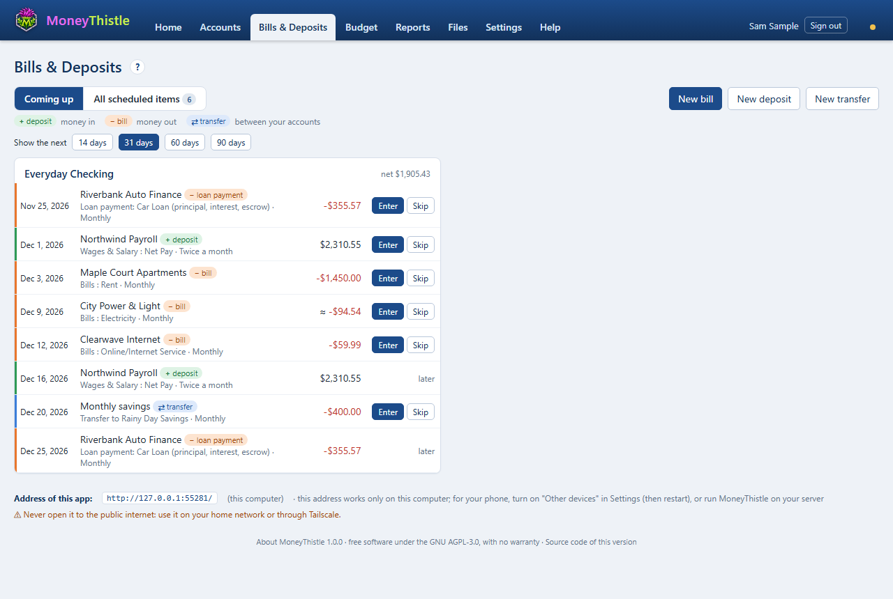
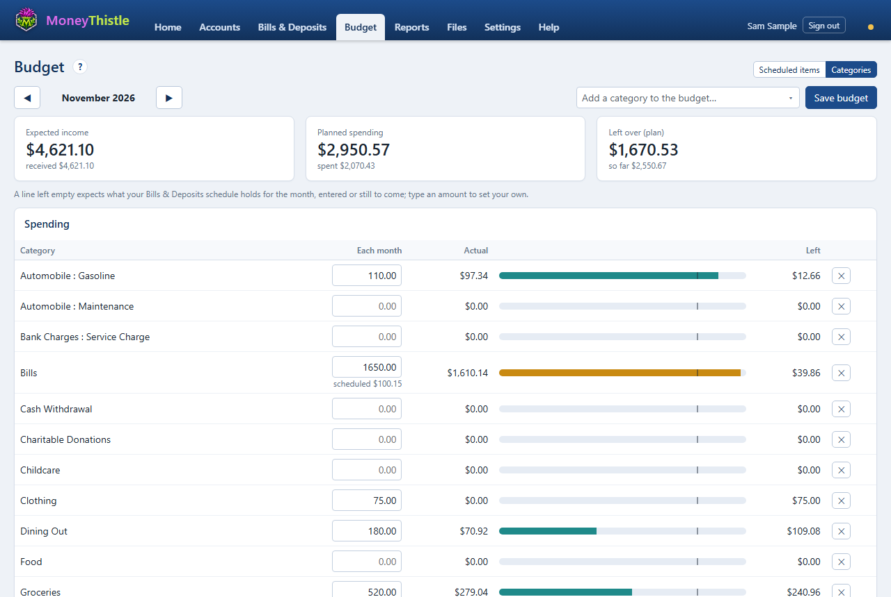
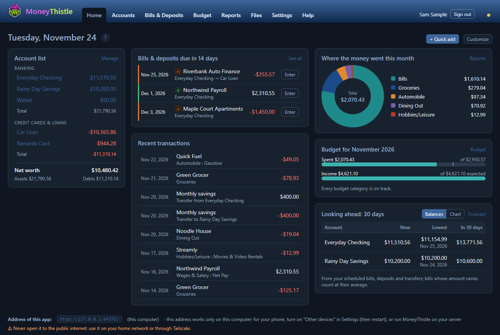

# MoneyThistle



*A Slightly Better Money App*

A simple personal money manager that opens in your web browser. It runs as a program on Windows,
as a container on Docker or Unraid, and on macOS or Linux with Python. Accounts and registers,
Bills & Deposits, paychecks and paystubs, budgets, reports and a year-end tax report, receipts,
and automatic backups to a folder and to Nextcloud (or any WebDAV server). No bank connection: type
transactions in, or import the files your bank lets you download. In English, French, Spanish and
Portuguese.



<table>
<tr><td></td>
<td></td></tr>
<tr><td></td>
<td></td></tr>
</table>

*(Made-up sample data. Try it yourself: a new install offers "Try it with sample data", and
"Start fresh" clears it when you're ready.)*

**What it's for:** household money, shared between the people in a home, and at most a very
simple sole proprietorship kept in its own environment. It is not business bookkeeping: no
invoices, receivables or payables, sales tax, payroll or double-entry books. It aims to do what it
does well rather than everything.

**How it was made:** MoneyThistle is "vibe coded". Nearly all of its code, screens, help and tests were
written by an AI (Anthropic's Claude) from plain-language requests; its human maintainer decided what it
should do, used and tested every feature, and has not reviewed the code line by line. It has automated
tests and everyday use behind it, but no professional code review or security audit: keep backups, keep
it off the public internet, and reviews and fixes are welcome. (In the app: Help → About MoneyThistle.)

Free and open source under the **GNU AGPL-3.0** (see `LICENSE`): use it, change it and share it;
if you offer a changed version to others, including as a hosted website, share your changes too.
What changed in each version: `CHANGELOG.md`.

**Name and logo:** the code is free to change and share, but the MoneyThistle name, logo and
wordmark identify this project. A changed version you share should have its own name and look,
so nobody mistakes it for MoneyThistle (saying it's "based on MoneyThistle" is welcome).

## Keep it off the public internet

**Never expose MoneyThistle to the public internet** (no port forwarding on your router, no public
reverse proxy). Use it only on your home network (LAN) or through a private VPN such as Tailscale.
It has sign-in, but it is not built or tested to withstand attacks from the internet, and nobody
can guarantee that a publicly exposed copy is safe. Securing such a setup is beyond what this
project takes responsibility for.

The `localhost` / `127.0.0.1` address works only on the computer MoneyThistle runs on. A phone or
another computer needs the server's network address (for example `http://192.168.1.20:8080/`) or
its Tailscale name.

## Install

### Windows

Download **MoneyThistle-Setup-….exe** from the [latest release](https://github.com/MoneyThistle/MoneyThistle/releases/latest)
and double-click it. It brings its own private copy of Python (it never touches another one),
installs for you only (no administrator rights), adds MoneyThistle to the Start menu and to
*Settings → Apps → Installed apps* (with Uninstall), and opens it in the browser to set up.

Until the setup is code-signed, Windows may say *"Windows protected your PC"* the first time:
choose **More info → Run anyway**.

Your money data is never touched by installing, updating or uninstalling (uninstall asks whether
to delete it, and suggests No).

### Unraid

MoneyThistle runs from a ready-made image, `ghcr.io/moneythistle/moneythistle`, so nothing is
copied to the server by hand. Until it's listed in Community Applications, add its template once:

1. Open the Unraid terminal (the `>_` icon) and run:

   ```
   wget -O /boot/config/plugins/dockerMan/templates-user/my-MoneyThistle.xml https://raw.githubusercontent.com/MoneyThistle/MoneyThistle/main/unraid/moneythistle.xml
   ```

2. **Docker → Add Container**, choose **MoneyThistle** under *Template*, check the port, folders,
   time zone and (optional) first password, and **Apply**.
3. Open `http://TOWER:8080` from any device on your network, or over Tailscale with the server's
   Tailscale name, e.g. `http://tower.your-tailnet.ts.net:8080`.

Your money file is in `/mnt/user/appdata/moneythistle/data` and local backups in
`/mnt/user/appdata/moneythistle/backups`, owned by `nobody:users` like other Unraid apps.

### Docker and Docker Compose

```
docker run -d --name moneythistle -p 8080:8080 \
  -v /path/to/moneythistle/data:/data -v /path/to/moneythistle/backups:/backups \
  -e TZ=America/New_York --restart unless-stopped ghcr.io/moneythistle/moneythistle:latest
```

Or download `docker-compose.yml` from this repository into a folder and run `docker compose up -d`
there (it keeps `./data` and `./backups` beside it). Then open `http://SERVER:8080`.

Settings the container reads: `TZ`, `PUID`/`PGID` (who owns the files), optionally
`APP_USERNAME`/`APP_PASSWORD` (the first administrator, created on the very first start only) and
`WEBDAV_URL`/`WEBDAV_USER`/`WEBDAV_PASSWORD` (the Nextcloud backup).

### macOS and Linux

With Python 3.10 or newer (nothing else to install): download the source of the
[latest release](https://github.com/MoneyThistle/MoneyThistle/releases/latest), unpack it, and in
that folder run:

```
python3 main.py --background   # keeps running after the window closes; opens http://localhost:8080
python3 main.py --stop         # stops it (backs up first)
```

## Updates

MoneyThistle asks GitHub once a day whether a newer version is out. It sends only its own
version number, nothing about you or your money, and you can turn this off under
**Settings → This computer → Updates**. When there is one, administrators see a note on Home.

- **Windows:** **Update now** downloads the new setup, checks it against the checksum published
  with the release, and installs it: MoneyThistle saves, backs up, updates and starts again by
  itself. Tick *Install new versions by itself* to skip the click.
- **Unraid:** the Docker tab shows *update ready* for MoneyThistle; click it. An auto-update
  plugin can do that for you. To stay on one version, change the template's *Repository* from
  `:latest` to a version, like `ghcr.io/moneythistle/moneythistle:1.0.0` (exactly that version)
  or `:1.0` (that version and its fixes).
- **Docker Compose:** `docker compose pull && docker compose up -d`. Pin a version the same way,
  in `docker-compose.yml`.
- **macOS and Linux:** replace the folder's files with the new version's, then restart.

Your data is kept through every update.

## Using it

### Locked out?

On the sign-in page, *Forgot your password?* emails a one-time link (30 minutes) when the sign-in has an
email address and an administrator has set up email under Settings → Notifications. Any administrator can
also set a new password under People. If you're the only administrator and can't get in, run this on the
computer or server MoneyThistle runs on (being able to do that proves it's yours):

```
python main.py --reset-password YOUR-USER-NAME                                 # in the MoneyThistle folder
docker exec -it moneythistle python main.py --reset-password YOUR-USER-NAME   # Docker / Unraid
python main.py --list-users                                                    # the user names
```

### Moving in from another program

Settings → *Bring in everything from another program…* reads QIF exports (Microsoft Money: one file per
account, chosen together; Quicken, Moneydance, KMyMoney, HomeBank, Money Manager Ex, Banktivity: one file)
and CSV exports from YNAB, GnuCash, Actual Budget, Mint and Firefly III (or any CSV with an Account column).
You see a preview and choose, per account, its type and whether it becomes a new account, goes into an
existing one or is left out. Accounts, opening balances, categories, payees, splits, transfers and cleared
marks come across, and investment accounts' dividends, interest and transfers; scheduled bills, budgets and
investment holdings don't.

### People, sign-in and environments

Everyone signs in with their own user name and password. On the very first start you create the
first sign-in in the browser (or give it as `APP_USERNAME` / `APP_PASSWORD`); it becomes the
administrator and the owner of the first money file, the "Personal" environment.

- **People** (administrators): add sign-ins, reset passwords, make someone an administrator.
- **Environments**: separate sets of accounts (Personal, Business, In-laws...). Only members see
  one. Owners add members as owner, editor (can change things) or viewer (can only look).
- **Shared accounts**: show one account in another environment too (for example your checking in
  your spouse's personal environment): one register, one balance, seen in both. View only, or
  entering transactions as well; optionally with its bills & deposits ("Share related Bills &
  Deposits"), so bills added on either side show on both. An owner of the other side approves.
- **Connections**: to move money between environments (personal checking -> business checking),
  an owner of one side asks and an owner of the other side approves and picks the account. Then
  "Transfer to ..." in either register fills in the other side. Either owner can end it.

Backups hold everything (all environments and sign-ins) in one zip. Over plain `http` on your own
network and Tailscale (which is encrypted) this is fine; don't forward the port to the internet.

### Backups to Nextcloud

In the app open **Backups**, tick *Nextcloud or another WebDAV server* and fill in:

- Folder address: `https://YOUR-CLOUD/remote.php/dav/files/YOUR-USER/Backups/Money`
- User name: your Nextcloud user
- Password: an **app password** (Nextcloud → Settings → Security → Create new app password)

Or set `WEBDAV_URL`, `WEBDAV_USER` and `WEBDAV_PASSWORD` on the container.
If Nextcloud runs on the same Unraid server, use its LAN address (e.g. `http://TOWER:8666/...`)
or its usual https address.

Back up after changes (keep 3), a scheduled backup every 14 days (keep 3), compressed. On top of
those, the last backup of each of the latest 7 days, 4 weeks and 12 months is kept. Any backup can
be restored from the Backups page.

### Starting over from a backup (lost computer, new server)

1. Install MoneyThistle as usual. Don't create a sign-in.
2. Open it: under *Set up MoneyThistle* choose **Start from a backup instead**, then pick a backup
   file (`money-….zip` / `.zip.enc` + its backup password) or enter your Nextcloud backup folder and
   choose one of its backups.
3. Sign in as before. Set again what belongs to the computer: notifications, other devices, start-up
   (and the Nextcloud connection if you restored from a file).

Without a browser: stop MoneyThistle, run `python main.py --restore money-….zip.enc` (it asks for
the backup password, or set `BACKUP_PASSWORD`), then start it.

### Where your files go

Settings → This computer shows the exact folders.

| Install | Program | Money data, log and local backups |
|---|---|---|
| Windows | `%LOCALAPPDATA%\Programs\MoneyThistle` | `%APPDATA%\MoneyThistle` (e.g. `C:\Users\you\AppData\Roaming\MoneyThistle`) |
| macOS | wherever you put the folder | `~/Library/Application Support/MoneyThistle` |
| Linux | wherever you put the folder | `~/.local/share/moneythistle` |
| Docker Compose | the image | `./data` and `./backups` beside `docker-compose.yml` |
| Unraid | the image | `/mnt/user/appdata/moneythistle/data` and `.../backups` |

Keeping the data outside the program means replacing or deleting the program never touches your
money files. `--data FOLDER` (or `DATA_DIR`) picks any other folder. If it ever stops on its own,
`moneythistle.log` in the data folder says why.

## For developers

```
python main.py            # runs while this window stays open; opens http://localhost:8080
python main.py --demo     # start with sample data
python -m unittest discover -s tests
python tools/build_windows.py   # dist/MoneyThistle-Setup-<version>.exe (with Inno Setup 6)
docker build -t moneythistle .  # the container image
```

How releases, the container image, the Unraid template, code signing and updates fit together, and
the steps for publishing a new version: [docs/PUBLISHING.md](docs/PUBLISHING.md). Notes for coding
agents: [CLAUDE.md](CLAUDE.md).
